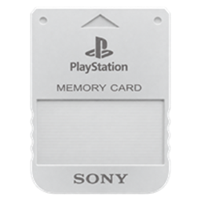

<div align="center">
  

# UniversalSaveEditor

**A portable Windows application for reviewing and editing supported PC game save data locally.**

[](https://github.com/DanCarrillo11/UniversalSaveEditor/releases/latest)
[](https://github.com/DanCarrillo11/UniversalSaveEditor/actions/workflows/tests.yml)
[](requirements.txt)
[](https://github.com/DanCarrillo11/UniversalSaveEditor/releases/latest)
[](LICENSE)

[Download](https://github.com/DanCarrillo11/UniversalSaveEditor/releases/latest) · [Compatibility](#compatibility) · [Documentation](docs/) · [Contributing](CONTRIBUTING.md)

</div>

> [!IMPORTANT]
> The application updates the opened save **in place** and does **not** create an automatic backup or renamed edited copy. Back up valuable saves, close the game before editing, and review every change before applying it.

## What it offers

- One searchable PySide6 interface for a catalogue of **23 PC games**.
- Local editing: no account, Python installation, or save upload is required for the packaged app.
- A complete pending-change review before anything is written.
- Format-specific validation, integrity warnings, and explicit repair choices.
- Portable Windows releases, light/dark themes, recent saves, favorites, and keyboard shortcuts.
- Detailed compatibility notes that separate verified behavior from experimental work.

Support is intentionally conservative. Catalogue presence does not mean full compatibility, and **no editor is currently labelled full support**.

## Quick start

1. Download **UniversalSaveEditor.exe** or the Windows ZIP from the [latest release](https://github.com/DanCarrillo11/UniversalSaveEditor/releases/latest). Extract the ZIP before running it.
2. Close the game. Select a game cover and let the app detect a save, or choose **Open save…**.
3. Select a slot or character, find a field by category or search, and make the change.
4. Open **View changes** or **Review and save**, resolve any validation issue, and select **Apply to active save**.

The file keeps its original name and location. If the game or Steam Cloud changes it while the editor is open, reopen the file before applying edits.

### Useful shortcuts

| Action | Shortcut |
|---|---|
| Open a save | **Ctrl+O** |
| Search | **Ctrl+F** |
| Recent saves | **Ctrl+R** |
| Review and save | **Ctrl+S** or **Ctrl+Enter** |

## Compatibility

The catalogue includes:

- **Rockstar:** Grand Theft Auto V, Red Dead Redemption 2 and Max Payne.
- **Resident Evil:** RE4 (2005), RE HD, RE2 (2019), RE3 (2020), RE4 (2023), RE5, RE6, RE7, Village and Requiem.
- **Kingdom Hearts:** Final Mix, II Final Mix, Re:Chain of Memories, Birth by Sleep Final Mix, Dream Drop Distance HD and III + Re Mind.
- **Other:** Elden Ring, WEBFISHING, Risk of Rain 2 and Alice: Madness Returns.

Coverage differs by save format, game revision, platform and slot. Some editors can apply documented changes directly; others remain limited or experimental, and several still require native-file or in-game verification.

For the exact editable fields and current evidence, see:

- [Coverage by game](docs/EDITOR_COVERAGE.md)
- [Current completion status](docs/CURRENT_GAME_COMPLETION.md)
- [Completion work list](docs/COMPLETION_PLAN.md)
- [Latest changes](CHANGELOG.md)

The app also shows game-specific evidence and limits under **Save details → Help & details**.

## Safety and privacy

- Editing happens locally; saves are not uploaded by the application.
- Diagnostics are shared only when you choose to copy them.
- Unknown or unsupported layouts are protected instead of being guessed.
- Integrity checks and successful reparsing reduce risk, but do not prove that an edited save will load in-game.
- Copied encrypted KH III, RE4 Remake and Requiem saves may require the original creator's SteamID64 for local decryption. It is not used to sign in.
- DLC features still require the corresponding game content.

## Quality and validation

The repository includes automated tests for parsing, edits, validation, preservation of unrelated data, UI behavior, updates and packaging. GitHub Actions runs the test suite and validates release builds.

Tests and reference files provide file-level evidence; they are not presented as proof of complete gameplay compatibility. Original reference saves remain unchanged during validation.

## Development

Requirements: Python 3 and the packages in [requirements.txt](requirements.txt).

```powershell
python -m venv .venv
.\.venv\Scripts\Activate.ps1
python -m pip install -r requirements.txt
python app.py
```

Run the automated suite:

```powershell
python -m unittest discover -s tests -v
```

Build the Windows executable:

```powershell
python -m pip install -r requirements-build.txt
python -m PyInstaller --clean --noconfirm UniversalSaveEditor.spec
```

Key modules:

| Path | Responsibility |
|---|---|
| [app.py](app.py) | Main PySide6 interface |
| [core.py](core.py) | Byte-preserving patches and verified file updates |
| [catalog.py](catalog.py) | Game catalogue and compatibility metadata |
| [tests/](tests/) | Automated application and format checks |
| [docs/](docs/) | Format research, evidence, limitations and work plans |

Do not commit personal saves. They may contain player names or account identifiers.

## Contributing

Bug reports, UI improvements, tests, documentation, and well-evidenced game support are welcome. Read [CONTRIBUTING.md](CONTRIBUTING.md) before opening a pull request.

New game additions are paused while the existing catalogue is completed. Resident Evil, beginning with Requiem, is the current priority.

## License and attribution

The source code is licensed under **GPL-3.0-or-later**. Game names, cover art and visible logos belong to their respective owners. See [SOURCES.md](SOURCES.md), [THIRD_PARTY_NOTICES.txt](THIRD_PARTY_NOTICES.txt), and [LICENSE](LICENSE).
